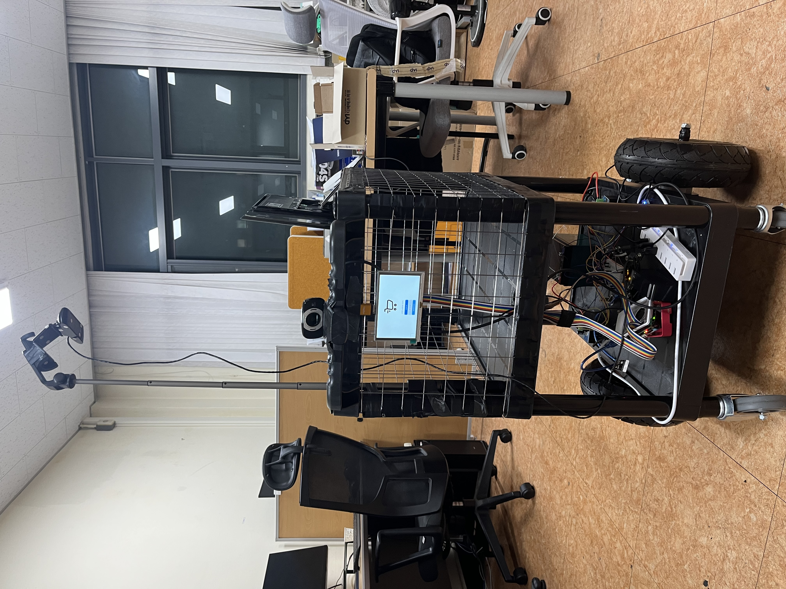
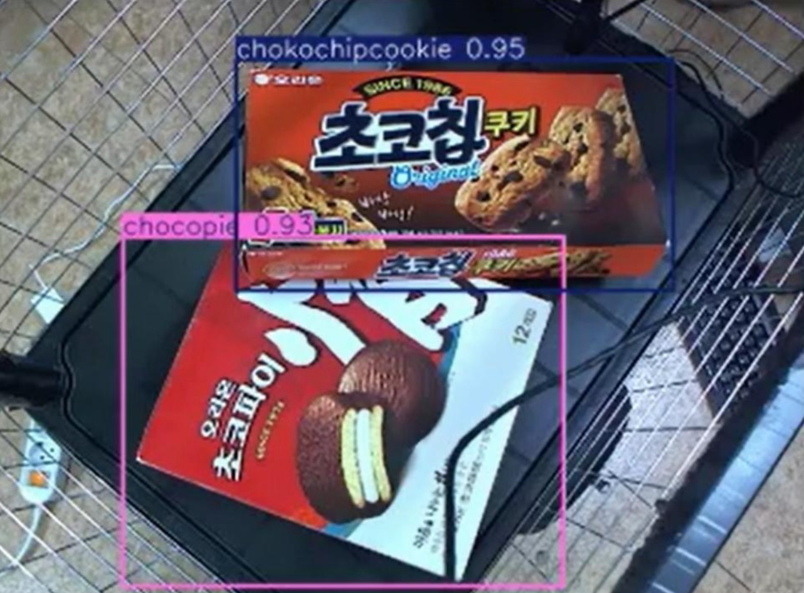
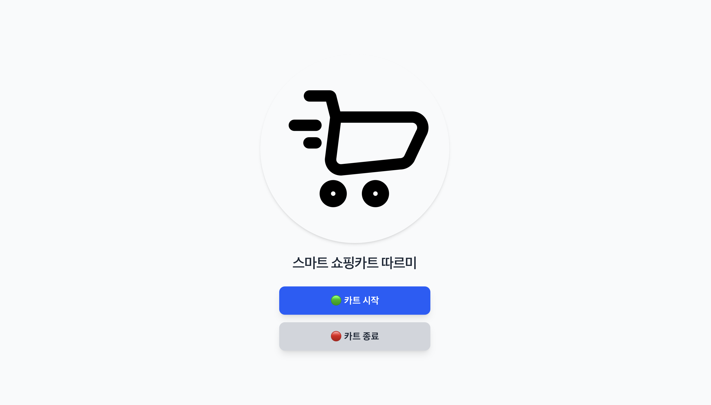
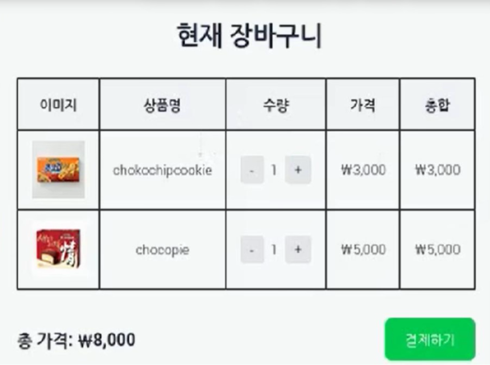

# 🛒 Tarumi (따르미)

### Smart Shopping Cart for Wheelchair Users

**Tarumi** is a smart shopping cart prototype designed to assist wheelchair users while shopping.

The system integrates wheelchair tracking, autonomous cart control, product recognition, and a web-based shopping cart interface. A Raspberry Pi 5 serves as the main computing platform, while camera-based vision pipelines are used to track the user and recognize products placed inside the cart.

This repository contains the **Ruby on Rails web application**, which I independently designed and developed as part of the Tarumi project. The application receives recognized product information from the vision pipeline, manages shopping cart sessions and product quantities, and provides the user interface displayed on the cart.

<p align="center">
  
</p>

<p align="center">
  <a href="https://www.youtube.com/watch?v=UA5QTQOUaPA">
    ▶️ Watch the System Demonstration
  </a>
</p>

---

## 📌 Overview

Tarumi was developed as an integrated smart shopping cart system for wheelchair users.

The complete prototype combines:

* Wheelchair tracking
* Autonomous cart movement
* Camera-based product recognition
* Raspberry Pi-based embedded computing
* Web-based shopping cart management
* Touchscreen user interaction

Within the overall system, this repository implements the **web application layer**.

The web application is responsible for:

* Creating and managing shopping cart sessions
* Receiving detected product names from the vision system
* Automatically registering detected products
* Managing product quantities
* Displaying product images and prices
* Calculating the total purchase amount
* Providing the cart and payment interfaces
* Starting and stopping the external Python detection process

---

## 👨‍💻 My Contribution

I independently designed and implemented the **Ruby on Rails web application** contained in this repository.

My work on the web component included:

* Rails backend and web interface development
* UUID-based shopping cart session management
* HTTP API integration with the product recognition pipeline
* Automatic registration of detected products
* Product quantity and price management
* Shopping cart and payment interfaces
* Raspberry Pi display-oriented user interface
* Integration for launching and stopping the external Python detection process

This repository represents the web component of the larger Tarumi system. The computer vision, tracking, and hardware-control components were developed as part of the team project.

---

## 🏗️ System Architecture

The complete Tarumi prototype integrates embedded hardware, computer vision, motor control, and the Rails web application.

```text
                     ┌─────────────────────┐
                     │     Raspberry Pi 5  │
                     └──────────┬──────────┘
                                │
              ┌─────────────────┴─────────────────┐
              │                                   │
              ▼                                   ▼
      Wheelchair Tracking                 Product Recognition
         Camera / Vision                    Camera / YOLO
              │                                   │
              ▼                                   │
      Cart Motion Control                          │
              │                                   │
              ▼                                   │
        Arduino / Motors                          │
                                                  │
                                                  ▼
                                       Python Detection Process
                                                  │
                                       POST /cart/yolo_detect
                                                  │
                                                  ▼
                                         Ruby on Rails API
                                                  │
                                  ┌───────────────┼───────────────┐
                                  │               │               │
                                  ▼               ▼               ▼
                              Products       Cart Items      Price / Quantity
                                  │               │               │
                                  └───────────────┼───────────────┘
                                                  │
                                                  ▼
                                               SQLite
                                                  │
                                                  ▼
                                         Shopping Cart UI
                                                  │
                                                  ▼
                                         Raspberry Pi Display
```

---

## 🔍 Product Recognition

Products placed inside the cart are recognized by the external vision pipeline.

<p align="center">
  
</p>

The detector sends recognized product names together with the current cart UUID to the Rails application through an HTTP POST request.

The Rails backend then looks up the corresponding products and updates the active shopping cart.

---

## 🖥️ Web Interface

### Cart Control

The main interface provides controls for starting and stopping the cart system.

<p align="center">
  
</p>

### Shopping Cart

Recognized products are automatically reflected in the shopping cart interface.

<p align="center">
  
</p>

Users can manually increase or decrease product quantities, while the application automatically updates individual subtotals and the total purchase amount.

---

## ✨ Features

* UUID-based shopping cart sessions
* HTTP API for product recognition results
* Automatic product registration
* Quantity accumulation for repeated detections
* Product image and price display
* Manual quantity increase/decrease controls
* Automatic subtotal and total-price calculation
* Payment completion flow
* External Python detector process control
* Raspberry Pi display-oriented interface
* Configurable detector and log paths

---

## 🛠️ Tech Stack

### Web Application

* Ruby 3.2.2
* Ruby on Rails 8
* Tailwind CSS
* SQLite

### Integrated Prototype

* Raspberry Pi 5
* Python
* YOLO-based object detection
* Google Coral TPU
* USB cameras
* Arduino
* Motor control system

---

## 🚀 Getting Started

The Rails web application can be run locally without the original embedded hardware.

### Requirements

* Ruby 3.2.2
* Bundler 2.6.7
* SQLite

### 1. Clone the Repository

```bash
git clone https://github.com/augustinus2000/kartweb.git
cd kartweb
```

### 2. Install Dependencies

```bash
bundle install
```

### 3. Prepare the Database

```bash
bin/rails db:prepare
bin/rails db:seed
```

### 4. Start the Application

```bash
bin/dev
```

Open the application at:

```text
http://localhost:3000
```

> The web interface can be tested independently. Full system operation requires the original Raspberry Pi, vision pipeline, and hardware components.

---

## 🔌 Detection API

The external product recognition process communicates with the Rails application through:

```text
POST /cart/yolo_detect
```

### Example Request

```bash
curl -X POST http://localhost:3000/cart/yolo_detect \
  -H "Content-Type: application/json" \
  -d '{
    "cart_uuid": "YOUR_CART_UUID",
    "detected": ["chocopie", "chocohaim"]
  }'
```

### Example Response

```json
{
  "status": "ok",
  "added": ["chocopie", "chocohaim"]
}
```

For each detected product, the backend looks up the product by name and either creates a new cart item or increments the quantity of the existing item.

---

## 🍪 Sample Products

The current seed data contains three products used during development:

| Product           |  Price |
| ----------------- | -----: |
| `chokochipcookie` | ₩3,000 |
| `chocopie`        | ₩5,000 |
| `chocohaim`       | ₩4,000 |

Initialize them with:

```bash
bin/rails db:seed
```

The seed operation is idempotent and can be executed repeatedly without creating duplicate products.

---

## ⚙️ Raspberry Pi Configuration

The original prototype used the following paths for the external detection environment:

```text
/home/kart/miniforge3/envs/coral/bin/python3.8
/home/kart/yolo_test/sort_coral_tpu.py
```

These remain the default values for compatibility with the original Raspberry Pi environment.

They can be overridden without modifying the source code:

```bash
export CART_PYTHON_PATH="/path/to/python"
export CART_DETECTOR_SCRIPT="/path/to/sort_coral_tpu.py"
export CART_LOG_PATH="/path/to/cart_log.txt"
export CART_ERROR_LOG_PATH="/path/to/cart_err.txt"
```

Then start the application normally:

```bash
bin/dev
```

---

## 🗄️ Data Flow

The core shopping cart relationship is:

```text
Cart
 └── CartItem
      └── Product
```

Each shopping session is identified by a UUID.

```text
Product detected
      │
      ▼
POST /cart/yolo_detect
      │
      ▼
Find Cart by UUID
      │
      ▼
Find Product by name
      │
      ▼
Create CartItem
      │
      └── or increment quantity
      │
      ▼
Render updated cart
```

---

## 🧪 Local Verification

The restored application has been locally verified for:

* Rails 8 application startup
* Tailwind CSS compilation
* Database initialization
* Idempotent product seeding
* UUID-based cart creation
* Detection API requests
* Automatic product insertion
* Quantity updates from repeated detections
* Multiple products in a single detection request
* Manual quantity increase/decrease
* Product price and total-price calculation
* Payment completion flow

---

## 📄 Publication

This project was presented at the **2025 IEMEK ICT College Student Paper Competition (대한임베디드공학회 ICT대학생논문경진대회)**.

**Smart Shopping Cart for Wheelchair Users "Tarumi"**
*휠체어 사용자를 위한 스마트 쇼핑 카트 "따르미"*

**Soeun An**, Gyeongheon Kim, Heeyoung Do, **Junhyeok Im**, Hanhoon Park

*Proceedings of the IEMEK ICT College Student Paper Competition*, pp. 112–114, June 2025.

🏆 **Outstanding Paper Presentation Award (우수 논문 발표상)**

---

## 🎥 Demo

A demonstration of the integrated Tarumi system is available on YouTube:

**[▶ Watch the Tarumi Demonstration](https://www.youtube.com/watch?v=UA5QTQOUaPA)**

---

## 📂 Repository Scope

This repository contains the **Ruby on Rails web application** developed for the Tarumi prototype.

The original computer vision, wheelchair-tracking, and embedded hardware-control code is not fully included in this repository. Therefore, the Rails application can be reproduced locally, while complete hardware operation requires the external components used in the original prototype.

---

## 📜 Project Note

This repository preserves the web application developed for the original academic prototype and has been refreshed to make the application easier to reproduce and understand.
